# Herramienta de medida y mapeo de WiFi sobre planos

**Redes Móviles e Inalámbricas** · Grado en Ingeniería Informática · FIC, Universidade da Coruña
Curso 2026–2027

Herramienta de línea de comandos en Python para realizar **campañas de medida WiFi sobre los planos de un edificio** y analizar los resultados. Permite situar cada medida sobre el plano, capturar todas las redes visibles con `iw`, y después visualizar la cobertura de un punto de acceso sobre el plano, la evolución del RSSI con la distancia o el detalle de los APs detectados en un punto. La usé para medir la cobertura de la red WiFi de la segunda planta de la Facultad de Informática.

En una práctica posterior, con mediciones tomadas con esta misma herramienta, ajusté un **modelo de propagación log-normal** (*log-distance path loss* con sombreado gaussiano) para estimar el exponente de pérdidas del entorno.

> Por privacidad, el repositorio no incluye las mediciones reales y en las capturas se han ocultado los BSSIDs de la red de la facultad.

---
## Dependencias

A nivel de python, ver `requirements.txt`.
A nivel de arquitectura, utilidad de Linux (iw), para realizar la mediciones.

## Ejecución

```bash
sudo python3 main.py
```


## Consideraciones previas


1. En todos los modos, el plano se abre con la **misma resolución original** para que las coordenadas en píxeles seleccionadas durante las medidas coincidan con las utilizadas en el análisis.
2. Cuando el usuario deba introducir datos, lo que aparece entre **corchetes** `[...]` es el valor por defecto (se acepta pulsando Enter), y lo que aparece entre **paréntesis** `(...)` es un ejemplo del formato esperado.

---

## Modo 1 — Gestión del proyecto

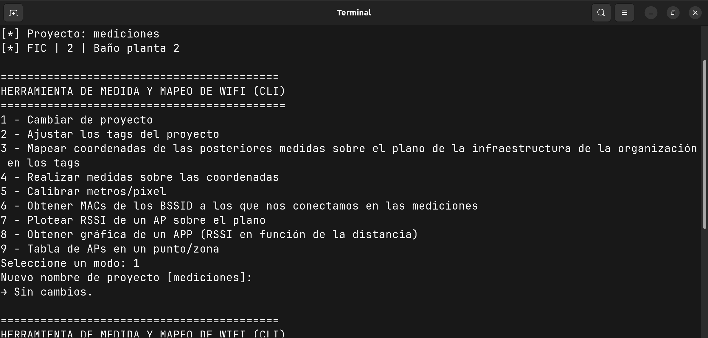

Permite crear o cambiar el proyecto activo. Se solicita el nombre del proyecto; si el archivo `data/<proyecto>.json` ya existe, las nuevas capturas se **añaden** a la lista existente. Si no existe, se crea. Este archivo JSON es el único destino de las mediciones realizadas en la sesión.

> Al cambiar de proyecto se resetean las coordenadas a `(0, 0)`. Es necesario usar el modo 3 antes de realizar nuevas medidas.

---

## Modo 2 — Ajuste de etiquetas (tags)

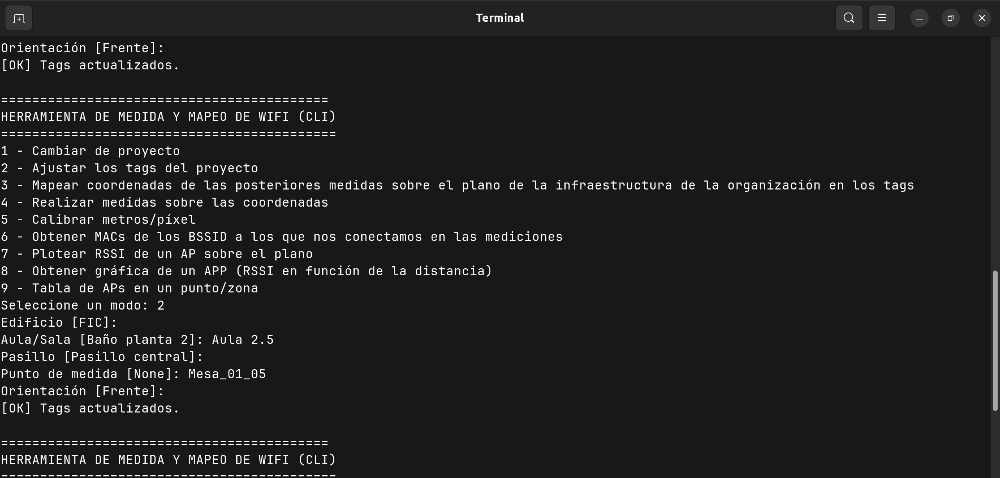

Gestiona los metadatos descriptivos del punto de medida: edificio, aula/sala, pasillo, identificador del punto y orientación. Estos valores se copian en cada registro de captura en el momento de su creación, de modo que todas las mediciones realizadas en ese punto quedan inequívocamente asociadas a su contexto espacial y de adquisición.

---

## Modo 3 — Mapeo de coordenadas sobre el plano

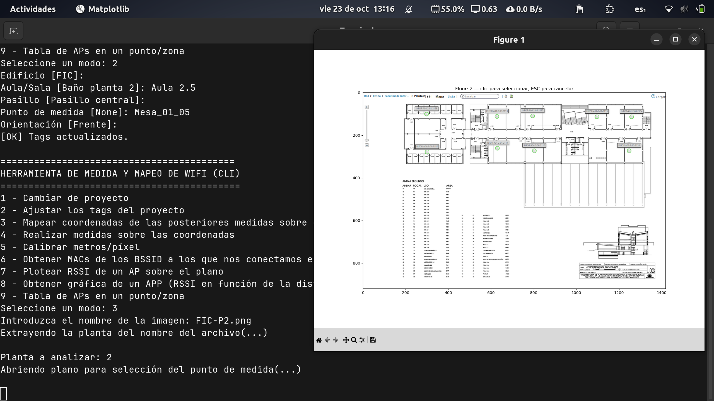

Se solicita el nombre del archivo del plano (p. ej. `FIC-P2.png`). La planta se extrae automáticamente del nombre del archivo. Se abre la imagen del plano en una ventana interactiva; el usuario hace clic sobre la posición exacta donde se realizarán las mediciones. Las coordenadas `(x, y)` en píxeles se guardan en la configuración de sesión y quedarán asociadas a todas las capturas que se tomen a partir de ese momento.

**Sistema de coordenadas:** origen en la esquina superior izquierda de la imagen, eje X hacia la derecha, eje Y hacia abajo. Unidades: píxeles de la imagen original.

---

## Modo 4 — Captura de medidas WiFi

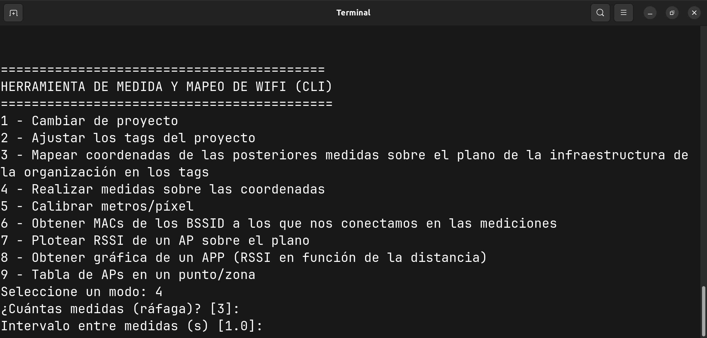

Realiza un escaneo activo de redes WiFi usando `iw dev <iface> scan ap-force` (invocado a través de `subprocess`). Esta operación requiere privilegios de superusuario: si la herramienta se va a usar para toma de medidas, debe lanzarse con `sudo python main.py`. Para análisis posterior sobre datos ya guardados, no es necesario.

Se solicitan dos parámetros:

- **Ráfaga** `[3]`: número de capturas independientes que se tomarán en ese punto.
- **Intervalo** `[1.0]` s: tiempo de espera entre capturas consecutivas.

Cada captura se guarda como un registro individual en `data/<proyecto>.json`, incluyendo timestamp, condiciones (tags + coordenadas) y todas las redes detectadas con sus parámetros (BSSID, SSID, RSSI en dBm, frecuencia, canal, ancho de canal, estándar, seguridad, estado de conexión).

---

## Modo 5 — Calibración de la escala (m/px)

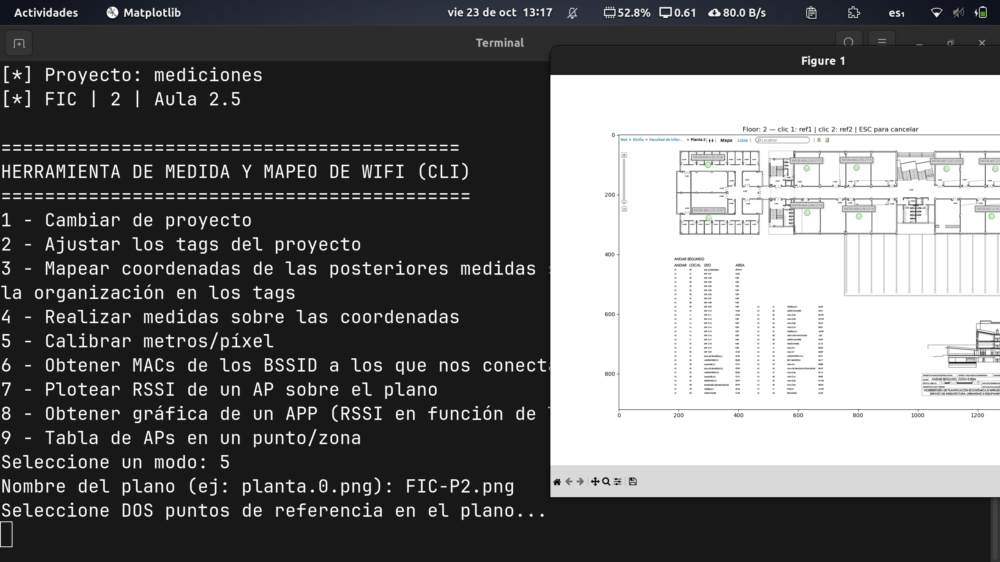
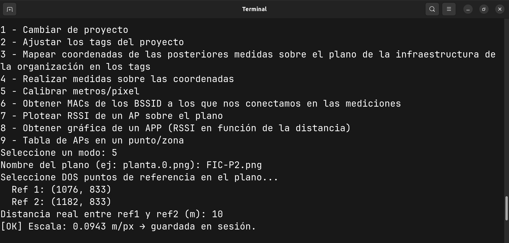

Permite calibrar la conversión de píxeles a metros. Se abre el plano y el usuario selecciona **dos puntos de referencia** cuya separación real es conocida (se recomienda usar la barra de escala del plano o dos elementos arquitectónicos con distancia medida). Tras introducir la distancia real en metros, se calcula:

$$m\_per\_px = \frac{d_{real}}{\sqrt{(x_2 - x_1)^2 + (y_2 - y_1)^2}}$$

El factor resultante se guarda en la configuración de sesión y se usa en los modos 7 y 8 para expresar distancias en metros.

---

## Modo 6 — Listado de APs detectados y conectados

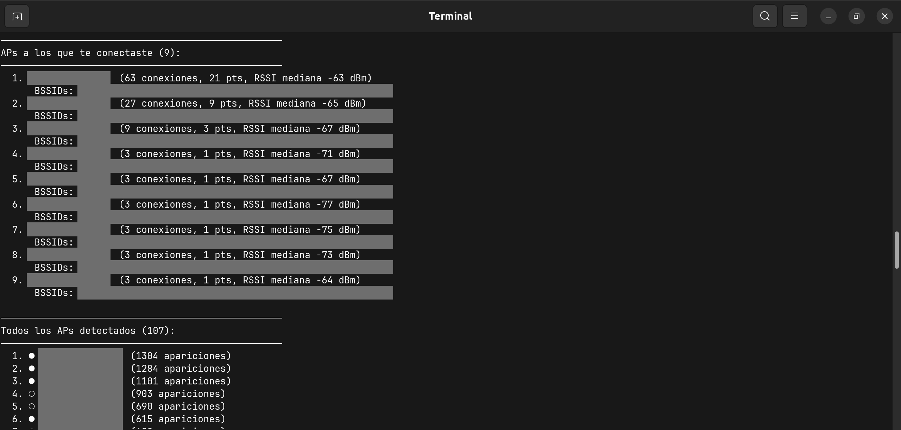

Muestra un resumen de los BSSIDs observados en las mediciones del proyecto activo, agrupados por **prefijo de 5 octetos** (se omite el último octeto de la MAC).

Esta agrupación se justifica porque un mismo AP físico emite BSSIDs distintos según la antena y el SSID. Por ejemplo, para un mismo AP es posible la siguiente situación:

| Banda | SSID | BSSID |
|-------|------|-------|
| 5 GHz | eduroam | `aa:bb:cc:dd:ee:10` |
| 5 GHz | udcdocencia | `aa:bb:cc:dd:ee:12` |

El prefijo `aa:bb:cc:dd:ee:*` identifica el AP físico. Esto es impuesto por el estándar 802.11: cada interfaz de radio (banda + SSID) tiene un BSSID propio, pero comparten los 5 primeros octetos.

La salida se organiza en dos bloques:
1. **APs a los que se conectó el equipo**: con nº de conexiones, nº de puntos distintos, mediana de RSSI y BSSIDs concretos.
2. **Todos los APs detectados**: con nº total de apariciones. Los que tuvieron conexión se marcan con `●`, el resto con `○`.

El prefijo de 5 octetos obtenido aquí es la entrada para los modos 7 y 8.

---

## Modo 7 — Plano con RSSI del AP seleccionado

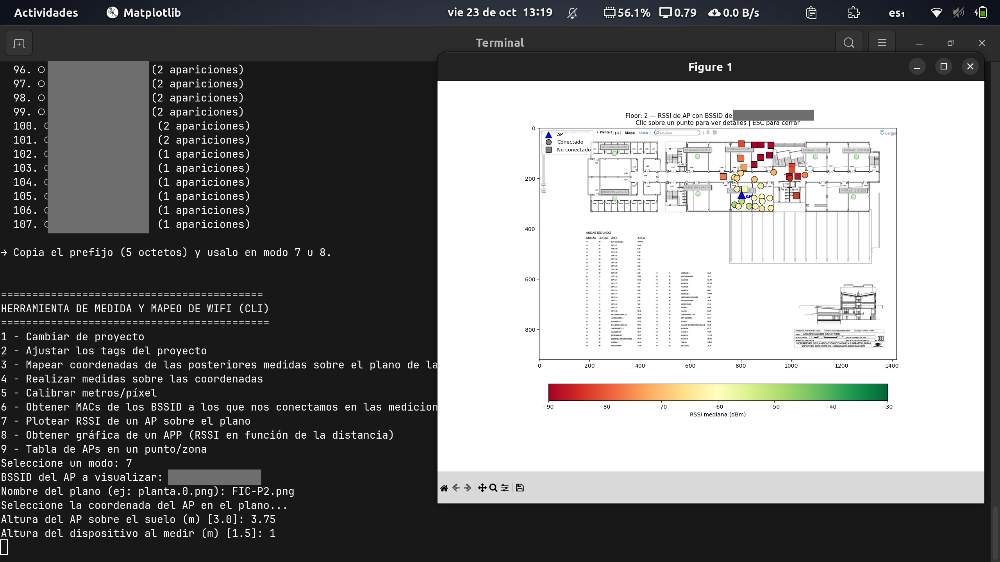
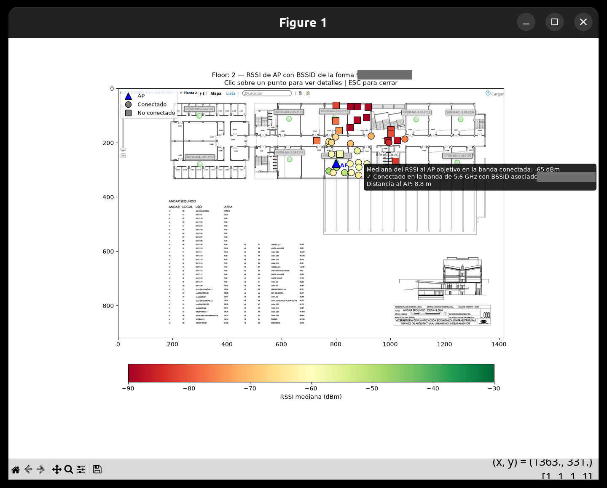
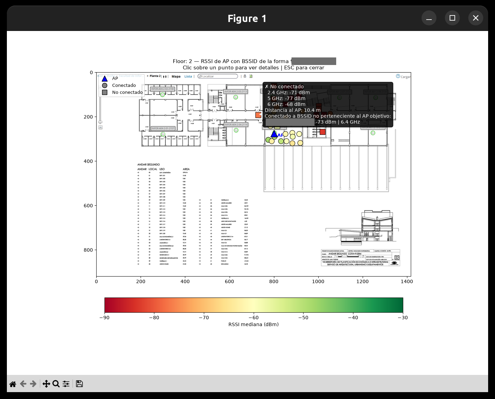

Genera una representación del plano con el AP seleccionado resaltado y los puntos de medida coloreados según el nivel de señal recibido.

**Entradas:**
- **BSSID del AP**: se acepta el BSSID completo (6 octetos) o el prefijo de 5 octetos (ver modo 6). En ambos casos se normaliza internamente a 5 octetos para agrupar todas las radios del mismo AP físico.
- **Plano**: nombre del archivo (se extrae la planta del nombre).
- **Coordenadas del AP**: se abre el plano y se hace clic sobre la ubicación del AP.
- **Altura del AP** `[3.0]` m y **altura del dispositivo** `[1.5]` m: se usa la diferencia `Δh` como componente vertical en el cálculo de distancia (Teorema de pitágoras).
- **Escala** `m_per_px`: se lee de la configuración (debe estar calibrada con el modo 5).

**Proceso:**
1. Se cargan las mediciones del proyecto activo.
2. Se **excluyen** las capturas cuya planta no coincide con la del AP (se informa del nº excluido).
3. Se agrupan las detecciones del BSSID objetivo por coordenada `(x, y)`.
4. Se hacen las filtraciones oportunas para conseguir lo que se explica a continuación...

**Representación:**
- El **AP** se marca con un triángulo azul y la etiqueta "AP".
- Los **puntos de medida** se dibujan como:
  - **Círculo** (`o`): el equipo estaba **conectado** al AP objetivo en alguna de las capturas de ese punto.
  - **Cuadrado** (`s`): el equipo **no estaba conectado** al AP objetivo (aunque lo detectaba).
- El **color** de cada punto lo determina la mediana del RSSI por cada banda, usando el colormap (rojo = señal débil → verde = señal fuerte). Ver Interactividad, a continuación...
- Se incluye una **barra de color** (colorbar) horizontal con la escala numérica en dBm.

**Interactividad (clic sobre un punto):**

Al hacer clic sobre un **círculo** (conectado) se muestra:
- Mediana del RSSI al AP objetivo en la banda conectada.
- BSSID asociado y frecuencia (GHz).
- Distancia al AP en metros (incluyendo la componente vertical).

Al hacer clic sobre un **cuadrado** (no conectado) se muestra:
- Mediana del RSSI por banda (2.4, 5, 6 GHz) para las detecciones del AP objetivo.
- Distancia al AP en metros.
- BSSID(s) al que(s) sí estaba conectado el equipo en ese punto, con su RSSI y frecuencia (para contextualizar).

---

## Modo 8 — Gráfica RSSI vs. distancia al AP

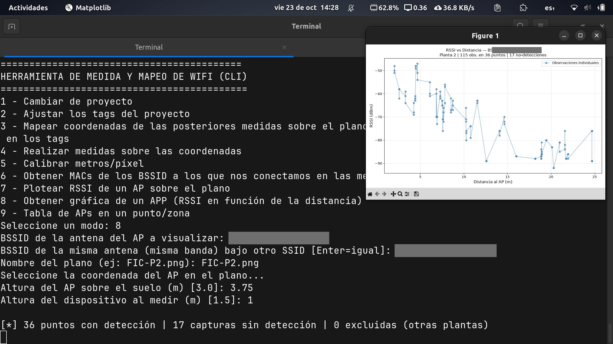

Genera una nube de puntos con la distancia al AP en el eje horizontal y el RSSI en dBm en el eje vertical.

**Entradas:**
- **BSSID principal** (6 octetos) y opcionalmente un **segundo BSSID** de la misma antena bajo otro SSID.
- **Plano**, **coordenadas del AP**, **alturas** y **escala**: como en el modo 7.

**Proceso:**
1. Se cargan las mediciones y se **excluyen** las capturas de otras plantas.
2. Para cada captura del mismo plano, se busca el BSSID objetivo (o el segundo) en la lista de redes. Si se detecta, se extrae `signal_dbm`.
3. Se calcula la **distancia en metros** a cada punto de medida:

$$d = \sqrt{(x_{AP} - x_{med})^2 + (y_{AP} - y_{med})^2 + \Delta h^2} \times m\_per\_px$$

4. **Cada observación individual** (una por captura) se plotea como un punto. No se agrupan ni se promedian: las repeticiones en el mismo punto se ven como múltiples puntos a la misma distancia.

**Salida:**
- Eje X: distancia al AP (m).
- Eje Y: RSSI (dBm).
- Título: BSSID, planta, nº de observaciones, nº de puntos, nº de no-detecciones.
- Las no-detecciones (capturas donde no aparece el BSSID) se cuentan pero no se plotean. No se sustituye un dato ausente por 0 dBm.

---

## Modo 9 — Tabla de APs en un punto o zona

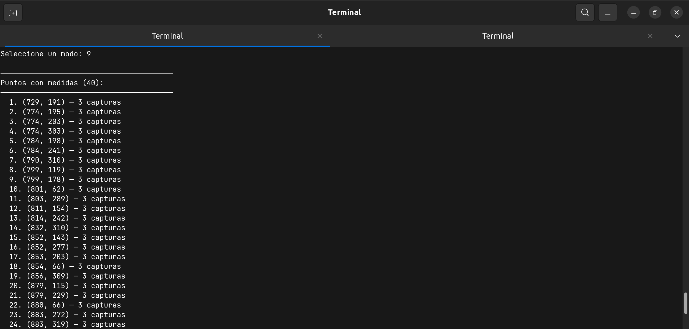
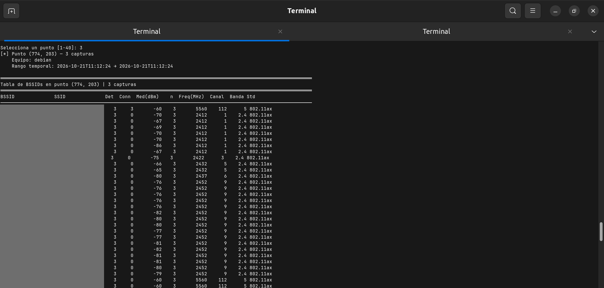
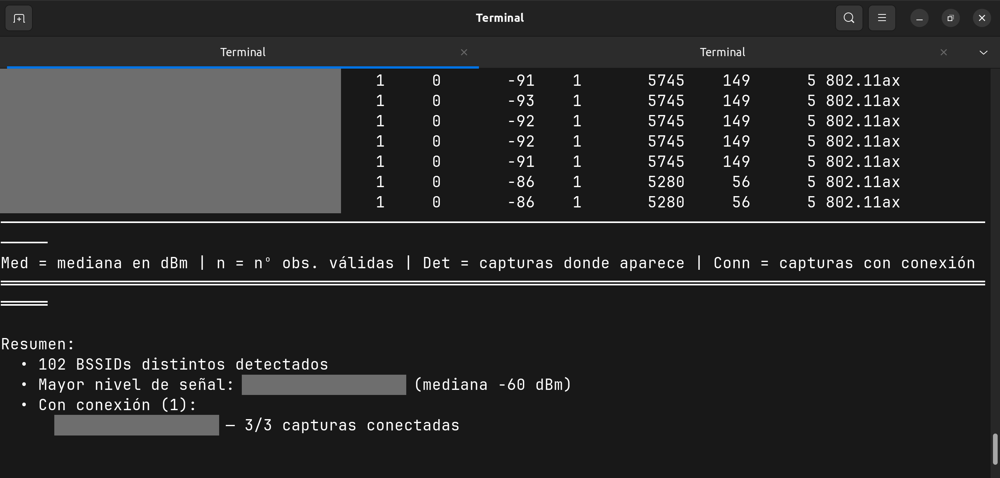
Genera una tabla resumen de los BSSIDs observados en un punto de medida seleccionado.

**Proceso:**
1. Se listan todos los puntos con capturas (coordenadas + nº de capturas).
2. El usuario selecciona un punto por número.
3. Se filtran las capturas de ese punto y se agrupan las redes por BSSID.

**Tabla resultante** (una fila por BSSID):

| Campo | Descripción |
|-------|-------------|
| BSSID | Identificador de la radio (6 octetos) |
| SSID | Nombre de la red (truncado a 17 caracteres) |
| Det | Nº de capturas en las que aparece ese BSSID |
| Conn | Nº de capturas con `connected = true` |
| Med(dBm) | **Mediana** de los RSSI válidos (no `null`) |
| n | Nº de observaciones de RSSI utilizadas para la mediana |
| Freq(MHz) | Frecuencia de la primera detección |
| Canal | Canal de la primera detección |
| Banda | Derivada de la frecuencia: 2.4 / 5 / 6 GHz |
| Std | Estándar 802.11 (n, ac, ax, be) |

**Resumen final:**
- Nº total de BSSIDs distintos detectados.
- BSSID con mayor nivel de señal (mediana más alta).
- BSSIDs a los que se observó conectado el equipo, con el nº de capturas conectadas.

**Método de resumen:** se utiliza la **mediana en dBm** porque es robusta a valores atípicos (picos por interferencia o multipath) y no requiere conversión a unidades naturales. La justificación completa de la elección de mediana en dBm se desarrolla en la memoria técnica.

---

## Formato de los datos

### `config/current_config.json`

Estado de la sesión: proyecto activo, metadatos del equipo, tags del punto, coordenadas y factor de calibración. Se actualiza en los modos 1, 2, 3 y 5.

### `data/<proyecto>.json`

Lista JSON de registros de captura. Cada registro es autocontenido:

```json
{
  "timestamp": "2026-10-20T10:32:15.123456",
  "project_name": "mediciones_FIC_P2",
  "conditions": {
    "device": { "hostname": "...", "os": "...", "wireless_interface": "wlp2s0" },
    "building": "FIC",
    "floor": "2",
    "room": "...",
    "corridor": "...",
    "point_id": "...",
    "coordinate_system": "Pixeles(Plano)",
    "coordinates": { "x": 512, "y": 340 },
    "orientation": "..."
  },
  "measurement_data": {
    "interface": "wlp2s0",
    "networks": [
      {
        "bssid": "aa:bb:cc:dd:ee:ff",
        "ssid": "FIC-5G",
        "channel": 36,
        "frequency_mhz": 5180,
        "signal_dbm": -52.0,
        "last_seen_ms": 5,
        "beacon_interval_tus": 100,
        "security": "WPA2",
        "standard": "802.11ax",
        "channel_width_mhz": 80,
        "connected": true
      }
    ],
    "count": 23
  }
}
```
